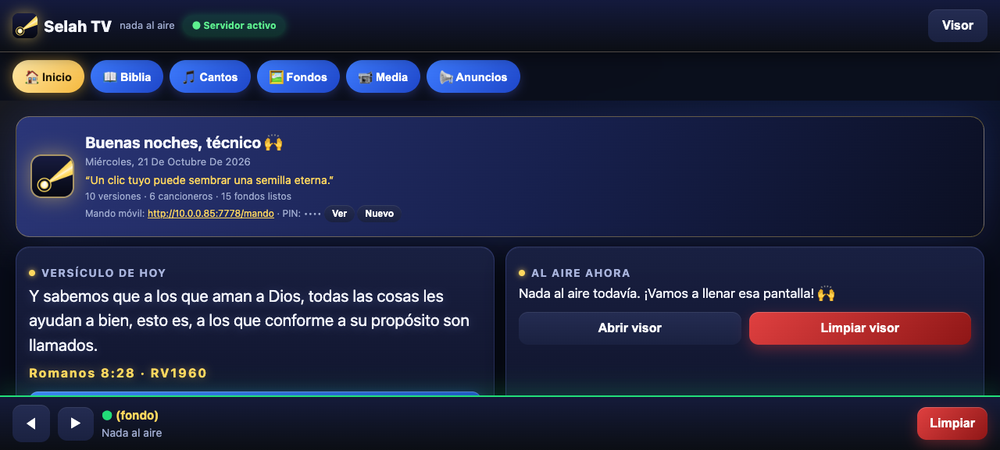
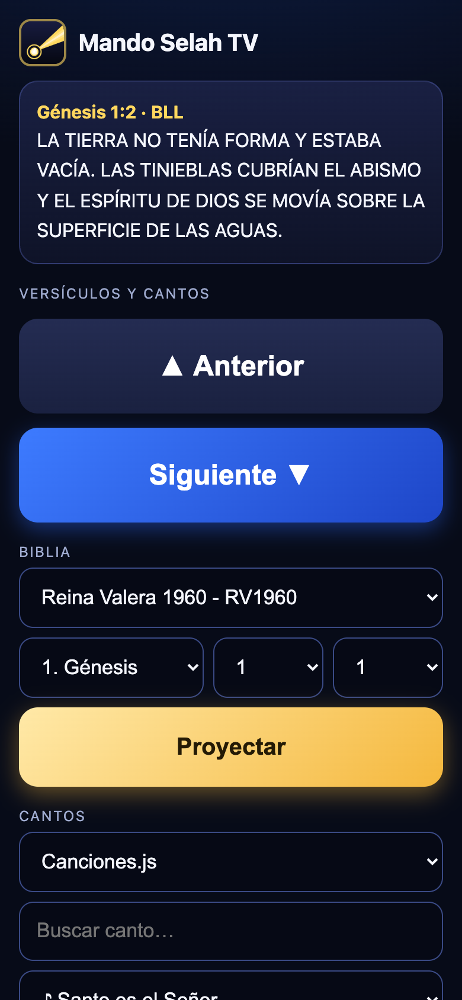

# 📖 Selah TV

**Proyección para el culto: Biblia, cantos, fondos, videos y anuncios — con mando móvil.**

*Hecho con fe, para servir a la iglesia.*

## Qué es

Selah TV convierte cualquier laptop en un centro de proyección para la iglesia:
el técnico opera desde el **panel**, la congregación ve el **visor** en la
pantalla o proyector, y un ayudante puede pasar versículos desde su **móvil**.

Sin cuentas, sin internet (salvo descargas opcionales), sin dependencias:
un solo servidor Python con la biblioteca estándar.

## Funciones

- 📖 **Biblias** — 10 versiones en español, caja mágica (`Salmos 23:1`,
  `Jn 3:16-17`), concordancia, dropdowns Libro/Capítulo/Versículo.
- 🎵 **Cantos** — píldoras con mostrar/quitar, diapositivas por estrofas,
  importar letras de internet a Mi Cancionero.
- 🖼 **Fondos** — pack Limpio (visor vacío) y Contenido (con contenido),
  galería internet gratuita, subida propia.
- 📹 **Media** — videos locales, YouTube con inicio/repetición, versículo
  sobre video.
- 📢 **Anuncios** — rotativos, cintillo, cuenta regresiva, alerta, marquesina,
  cada uno con su interruptor.
- 🏠 **Inicio** — saludo al técnico, versículo del día, al aire ahora,
  accesos rápidos, URL y PIN del mando.
- 📱 **Mando móvil** — biblioteca completa + anterior/siguiente + Faltan 5,
  con PIN de 4 dígitos.
- 🔄 **Actualización con un clic** — releases aquí mismo, con copia de
  seguridad y restauración.
- ✨ **Tema Selah Glow** — marino + dorado; 8 transiciones con velocidad.

## Capturas

### Inicio (panel del técnico)

### Visor limpio (congregación)

### Mando móvil

## Instalación (Windows)

1. Descarga `SelahTV-Windows-<versión>.zip` del último
   [Release](../../releases/latest).
2. Extráelo y abre `SelahTV.bat`. Sin instalar nada.
3. Acepta el aviso del firewall la primera vez.

En macOS: Python 3 + `python3 server.py` (ver `LEEME.md`).

## Actualizar

Panel → Anuncios → *Actualización de la app* → Buscar → Instalar.
La app se reinicia sola. Si algo falla: *Volver a la versión anterior*.

## Mando móvil

Laptop y móvil en el mismo wifi → abre la URL que muestra el Inicio
→ mete el PIN (está oculto tras *Ver*, solo para el técnico).

---

*«Lámpara es a mis pies tu palabra» — Salmos 119:105*
